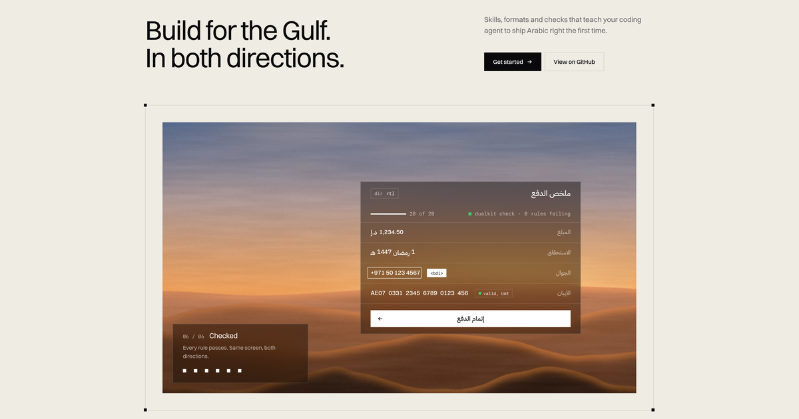
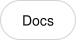
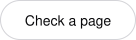
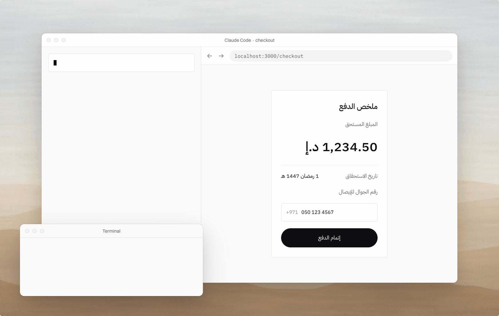
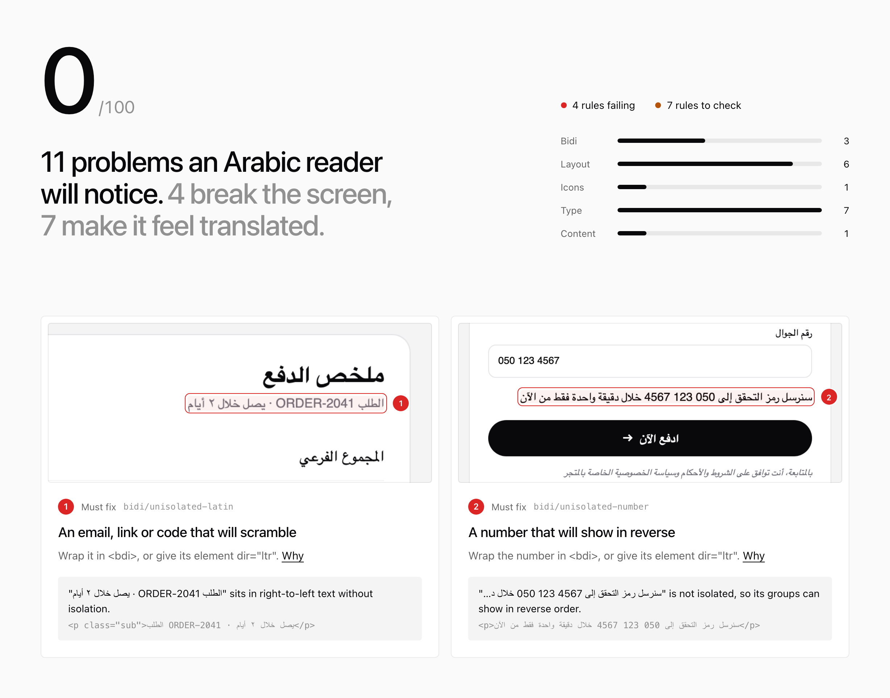

<p align="center">
  <a href="https://dualkit.dev"></a>
</p>

<p align="center">
  <a href="https://dualkit.dev"></a>&nbsp;
  <a href="https://dualkit.dev/docs"></a>&nbsp;
  <a href="#skills"></a>&nbsp;
  <a href="#check"></a>&nbsp;
  <a href="https://github.com/dualkit/dualkit/releases"></a>
</p>

<p align="center">
  <a href="#skills"></a>
</p>

<p align="center">Free, open-source tools for products that ship in Arabic and English. <b>v0.1 beta.</b></p>

## The problem

Ask Claude Code or Cursor for a bilingual screen and you get the same three bugs:

- A UAE phone number inside Arabic text renders backwards.
- A Hijri date comes out a day wrong near midnight.
- A code typed in Arabic digits fails validation.

Dualkit fixes them at the source, in the agent and in the code, and checks any page for the ones that got through.

<p align="center"></p>

| | What it is | Install |
| --- | --- | --- |
| **[Skills](plugin/skills/)** | Four agent skills for Claude Code and Cursor, listed in the Claude plugin directory: RTL layout, Arabic and Latin type pairing, Gulf formats, bilingual copy | `/plugin marketplace add dualkit/dualkit` |
| **[Format](packages/format/)** | Six Gulf currencies, Umm al-Qura dates, Arabic numerals, GCC phones and IBANs for all six countries, Emirates ID, Saudi VAT number, Gulf weekends. No dependencies | `npm i @dualkit/format` |
| **[Starter](packages/starter/)** | A bilingual design system to fork: one token file feeds CSS, Tailwind and Figma, plus eight React components | [From the release](#starter) |
| **[Check](packages/cli/)** | Audit any page for Arabic and RTL bugs, with a shareable Gulf-ready report | `npx dualkit check <url>` |

## Proof

Fresh agents built the same bilingual checkout three times without the skills and three times with them.

| Check | Without | With |
| --- | --- | --- |
| Phone and IBAN isolated inside Arabic text | 0/3 | 3/3 |
| Arabic type overrides (line height, size, tracking) | 0/3 | 3/3 |
| Digit system pinned, not left to defaults | 1/3 | 3/3 |

Three runs is a smoke test, not a benchmark. The task, the scorer and every run are in [`evals/payment-summary`](evals/payment-summary/RESULTS.md).

## Skills

The skills are listed in the Claude plugin directory, so you can install them from there in Claude Code, Cowork and the Claude apps. Or, in Claude Code:

```
/plugin marketplace add dualkit/dualkit
/plugin install dualkit@dualkit
```

In any agent that reads skills (Claude Code, Cursor, Codex and others):

```
npx skills add dualkit/dualkit
```

In Cursor, copy [`cursor/rules`](cursor/rules/) into your project's `.cursor/rules`. The rules are generated from the same source as the skills, and CI fails if they drift.

## Format

```
npm i @dualkit/format
```

```ts
import { formatMoney, formatHijri, parseUaePhone } from '@dualkit/format'

formatMoney(1234.5, { currency: 'AED', locale: 'ar', numerals: 'arab' }) // ١٬٢٣٤٫٥٠ د.إ
formatHijri(new Date('2026-02-18'), { timeZone: 'Asia/Riyadh' })          // 1 Ramadan 1447 AH
parseUaePhone('٠٥٠ ١٢٣ ٤٥٦٧')                                            // { ok: true, value: { e164: '+971501234567', type: 'mobile' } }
```

Full API in [the package README](packages/format/README.md).

## Starter

```
npm i @dualkit/starter
```

Then in your CSS:

```css
@import '@dualkit/starter/tokens.css';
@import 'tailwindcss';
@import '@dualkit/starter/theme.css';
```

`<html lang="ar" dir="rtl">` switches to Arabic type, and `data-theme="dark"` to dark mode. More in [the starter README](packages/starter/README.md).

The eight components install with the shadcn CLI, as source you own:

```
npx shadcn@latest add https://dualkit.dev/r/amount.json
```

Swap `amount` for `button`, `date-display`, `digit-input`, `field`, `sheet`, `tabs` or `toast`.

## Check

Point one command at any page, local or live. It opens it in Chromium, runs 20 Arabic and right-to-left rules, and writes a report with a score out of 100 and every bug marked on a screenshot.

```
npx playwright@1.55.0 install chromium   # once
npx dualkit check https://your-site.com/ar
```

<picture>
  <source media="(prefers-color-scheme: dark)" srcset=".github/assets/check-report-dark.png">
  
</picture>

In CI, `uses: dualkit/dualkit/action@main` scores every pull request and uploads the report ([action/README.md](action/README.md)). Every rule, why it matters and how to fix it is in [RULES.md](packages/rules/RULES.md).

## Contributing

The most useful help right now:

- **Read Arabic?** Review the skill rules in [`plugin/skills/`](plugin/skills/) and comment wherever something reads wrong.
- **Shipping in the Gulf?** Tell us where it breaks in [Discussions](https://github.com/dualkit/dualkit/discussions).
- **Want a first PR?** Say hello in [Discussions](https://github.com/dualkit/dualkit/discussions) and we'll find a small one.

## Repo

| Path | Contents |
| --- | --- |
| `packages/format` | The format library, with its tests |
| `packages/rules` | The 20 check rules and the page reader, with their tests |
| `packages/cli` | The `dualkit` CLI and its report |
| `action` | The GitHub Action that runs the check on pull requests |
| `skills` | The four skills (`SKILL.md` each) |
| `cursor/rules` | Cursor rules generated from `skills` |
| `packages/skills` | The generator and the tests that keep skills, rules and the plugin manifest in step |
| `apps/site` | dualkit.dev (Next.js) |
| `design` | Figma specs, tokens and the motion prototype the site was built from |
| `evals` | Baseline evaluations for the skills |

```
npm install
npm test
npm run dev
```

## Status

This is a beta. No native Arabic reviewer has checked the Arabic rules yet; that happens before 1.0. If any Arabic reads wrong, please [open an issue](https://github.com/dualkit/dualkit/issues).

Made by [Sam Santos](https://snts.im). MIT licensed.
